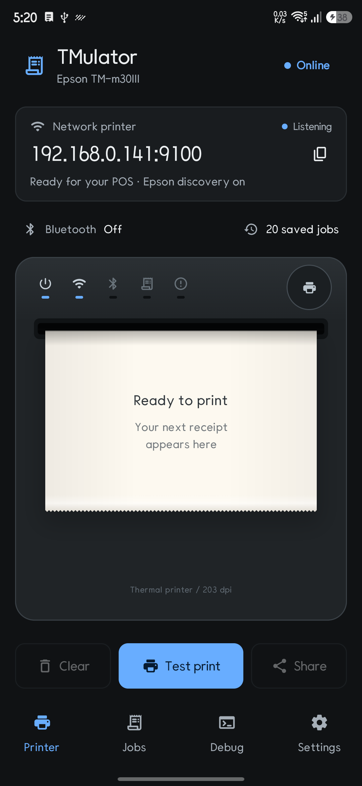
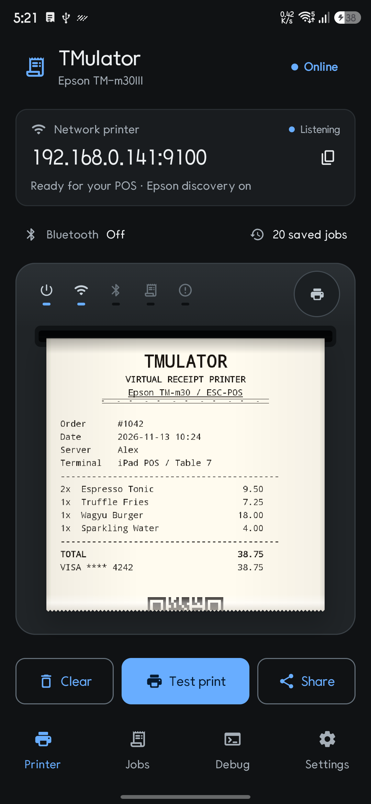

<div align="center">

# 🧾 TMulator

**A virtual thermal receipt printer for Android.**

Listen on TCP 9100, answer Epson ENPC discovery, and watch raw ESC/POS jobs become a live thermal-paper receipt.

[](#)
[](#)
[](#)
[](#)
[](https://github.com/kaiizu/tmulator/releases)
[](#build--test)

[**Download the APK**](https://github.com/kaiizu/tmulator/releases/latest) · [Features](#what-it-does) · [Build](#build--test) · [Limits](#compatibility--limits)

</div>

<p align="center">
  
  
</p>

## What is TMulator?

TMulator turns an Android phone into a local receipt printer. Point a POS app at
the phone's IP on port 9100 and print exactly as you would to a generic raw
ESC/POS network printer. TMulator parses the job and renders the receipt at
203-dpi-class width: 576 dots for 80 mm paper or 384 dots for 58 mm paper.

No physical printer, cloud account, or desktop server is involved. Jobs stay on
the phone, and completed receipts are saved locally with their metadata.

It is built around a real use case: an iPad POS that speaks Epson ENPC and raw
ESC/POS over Wi-Fi. TMulator answers the Epson discovery/hold handshake, accepts
the print job, and shows the receipt in a small animated printer interface.

## Quick start

1. Install **TMulator 0.3.3** on an Android 8.0+ phone.
2. Connect the phone and the POS device to the **same Wi-Fi network**.
3. Open TMulator. Network emulation is on by default and listens on TCP `9100`.
4. Note the address shown, for example `192.168.1.42:9100`.
5. In the POS app, add a **Generic Raw**, **ESC/POS network**, **Epson**, or
   **LAN/Wi-Fi** printer using that IP and port.
6. Choose a raw/ESC-POS mode where available. Do **not** choose AirPrint/IPP.
7. Print. The receipt appears on the phone and is saved to **Jobs**.

Some POS apps insist on Epson discovery. TMulator answers the common ENPC UDP
`3289` queries and the ENPC hold/release commands used by Epson's iPad SDK.
Epson ePOS-Print XML, AirPrint/IPP, and mDNS are not implemented.

## Test without a POS app

The app's **Test** button sends a full ESC/POS job through the real loopback TCP
server. It exercises text styles, raster images, QR, Code128, cut, and the
receipt renderer end to end.

You can also send the same kind of job from a computer on the same network:

```powershell
python tools/send-test-receipt.py 192.168.1.42
```

Probe Epson discovery with:

```powershell
python tools/enpc_probe.py 192.168.1.42
python tools/enpc_probe.py 255.255.255.255
```

## What it does

| Area | Details |
|---|---|
| **Network** | Raw TCP server on a configurable port (default `9100`), multiple clients, per-connection parsing |
| **Epson discovery** | ENPC UDP `3289` with TM-m30III-style identity payloads, active-holder reporting, hold/release acknowledgements |
| **Receipt model** | Text styles, alignment, line spacing, feeds, tabs, absolute position, full/partial cut, cash-drawer pulses |
| **Raster** | `GS v 0`, `GS 8 L`, `GS ( L` stored graphics, `ESC *`, `ESC K/Y/Z` column images |
| **Barcodes** | UPC-A/E, EAN-8/13, Code39, Code93, Code128, ITF, Codabar |
| **QR** | `GS ( k` model/module/ECC/store/print, plus recovery of POS-rasterized QR codes |
| **Status** | `DLE EOT 1–4`, `DLE ENQ`, `GS r`, `GS a` (ASB), `ESC v`, `GS I` |
| **Epson queue** | `GS ( H` process-ID echo observed on TM-m30 hardware |
| **Profiles** | TM-m30III, TM-m30, TM-T88VI, Generic 80 mm, Generic 58 mm |
| **Rendering** | Live 203-dpi-style bitmap, anti-aliased text, crisp 1-bit QR/barcodes, nearest-neighbour preview scaling |
| **Jobs** | Last 20 receipts as PNG + metadata, full-screen viewer, share/export, captured-text excerpt |
| **Runtime** | Foreground service, wake lock, low-latency Wi-Fi lock, notification actions, paper-out/cover-open simulation |
| **Bluetooth** | Best-effort SPP endpoint for Android/Windows clients; not an MFi/iAP printer |

All receipt data stays on the device. The app has no accounts, cloud sync, or
external analytics.

## Settings worth knowing

| Setting | Purpose |
|---|---|
| Network emulation / TCP port | Raw ESC/POS listener |
| Epson ENPC discovery | Epson SDK discovery on UDP `3289` |
| Printer / Bluetooth name | Advertised identity (default `TM-m30III`) |
| Emulated profile | Paper width, model ID, and Epson extension replies |
| Auto-scroll | Follow the paper as it prints |
| Keep awake | Partial wake lock + low-latency Wi-Fi lock for background reliability |
| Verbose command log | Log every parsed command for support work |
| Simulate paper out / cover open | Change status replies for POS testing |

## Build & test

Requirements: JDK 17 or 21, Android SDK 35, and the Gradle wrapper included in
the repository.

```powershell
$env:JAVA_HOME = "C:\path\to\jdk-21"
$env:ANDROID_HOME = "$env:LOCALAPPDATA\Android\Sdk"

.\gradlew.bat :app:assembleDebug
.\gradlew.bat :app:testDebugUnitTest
.\gradlew.bat :app:lintDebug
```

The project currently has **59 JVM tests** covering the parser, receipt model,
raster/QR recovery, ENPC framing, real loopback TCP, and lifecycle regression
probes. The release APK is locally signed for sideloading; it is not a Play
Store build.

See [SPEC.md](SPEC.md) for the protocol research and design rationale.

## Project layout

```text
app/src/main/java/dev/tmulator/
  escpos/     pure-Kotlin receipt model, code pages, incremental ESC/POS parser
  render/     Android Canvas thermal raster renderer
  transport/  TCP 9100 server, ENPC UDP responder, Bluetooth SPP server
  service/    foreground service, listener lifecycle, job manager
  data/       settings, runtime state, local job persistence
  ui/         Compose Material 3 screens (printer, jobs, debug, settings)

tools/                                Python send/probe diagnostics and audit probes
SPEC.md                               feasibility, architecture, limitations
AUDIT_REPORT.md                       independent code audit and action plan
```

## Compatibility & limits

- **Not a cycle-accurate Epson emulator.** Page mode, macros, user-defined
  characters, some advanced graphics/user-setting commands, and ePOS XML are
  not implemented.
- **Discovery is ENPC only.** No Bonjour/mDNS, SNMP, IPP/AirPrint, or Star
  discovery.
- **Bluetooth MFi/BLE emulation is not possible** from a normal Android app.
  iPad POS apps that require Epson MFi Bluetooth must use Wi-Fi.
- **Raw port is unauthenticated**, exactly like a real raw printer. Use it only
  on trusted networks.
- **Aggressive OEM battery savers** can still kill background sockets. Disable
  battery optimization for TMulator if the listener must survive long idle
  periods.
- **AirPrint/IPP and ePOS-Print XML** are intentionally out of scope.

## Diagnostics & audit

- `tools/send-test-receipt.py` sends a realistic ESC/POS job over TCP.
- `tools/enpc_probe.py` checks ENPC unicast and broadcast discovery.
- Debug shows live listener state, client activity, command counts, RX/TX hex,
  unsupported commands, and the first raw bytes of every job.
- [AUDIT_REPORT.md](AUDIT_REPORT.md) documents the independent audit, reproduced
  findings, fixes, and remaining hardening work.
- [SPEC.md](SPEC.md) contains the protocol research and architecture notes.

## Credits

- Receipt interface design workflow guided by
  [Unslop](https://github.com/heydamir/unslop) by Damir Sokolovsky
  ([@heydamir](https://x.com/heydamir)), licensed CC BY 4.0.
- ESC/POS references:
  [Epson process-ID response format](https://download4.epson.biz/sec_pubs/pos/reference_en/escpos/gs_lparen_ch_fn48.html),
  [TM-m30 capture and response examples](https://wes4m.io/posts/epson_rev/),
  [ENPC framing reference](https://github.com/BlackLotus/epson-stuff).
- QR and barcode encoding by [ZXing](https://github.com/zxing/zxing).

---

<p align="center"><sub>Built for testing receipt flows without burning a roll of paper.</sub></p>
